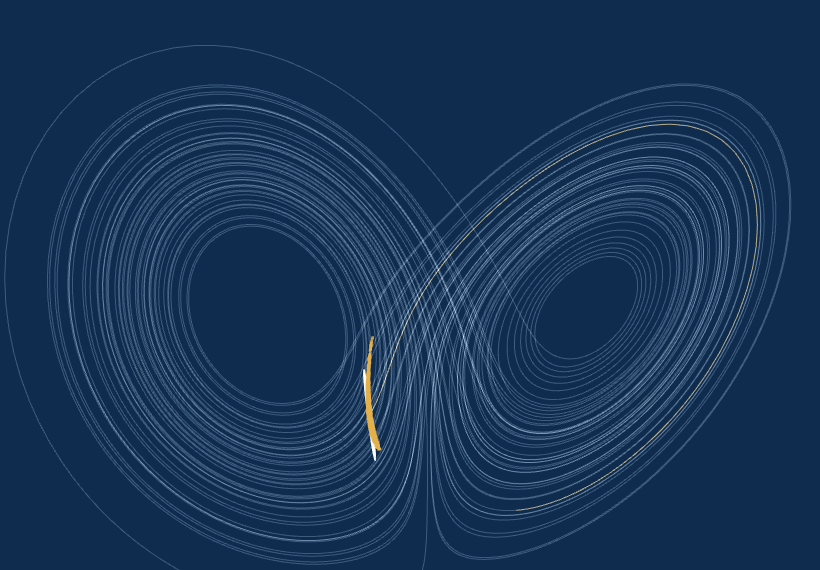
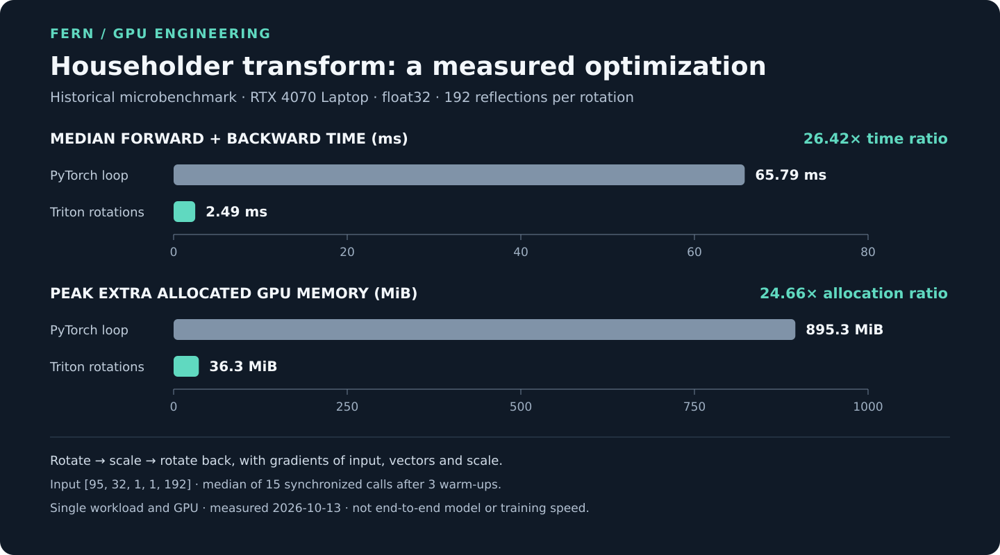
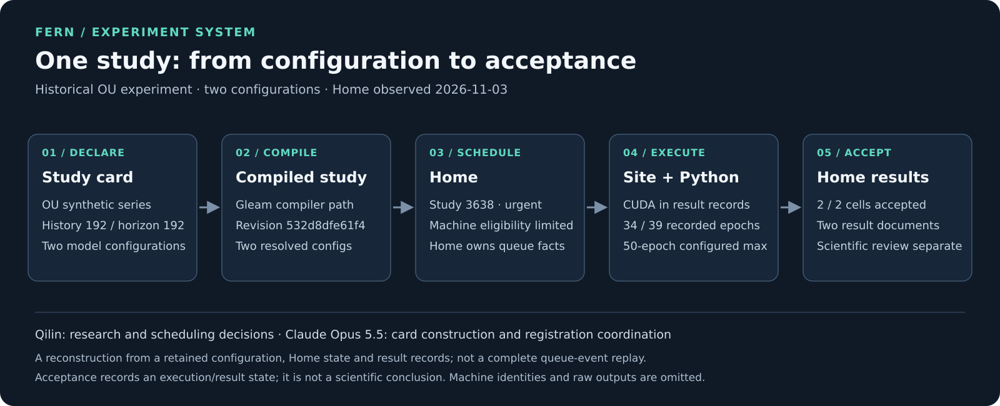

# Qilin Wang

**ML research · time-series forecasting · uncertainty · research engineering**  
**[ICML 2026 · single-author paper](https://arxiv.org/abs/2505.17370)** · Montréal · [LinkedIn](https://www.linkedin.com/in/qilin11/)

[Fern code](https://github.com/QilinWang/Fern-icml2026) · [SERIE: interactive demo](https://qilinwang.github.io/serie/) · [GPU case study](showcase/householder-kernel.md) · [Experiment system case study](showcase/fern-experiment-system.md) · [Stage flow and design](showcase/stages-and-boundaries.md)

<a href="https://fern-forecasting.netlify.app/">
<picture>
  <source media="(prefers-reduced-motion: reduce)" srcset="https://raw.githubusercontent.com/QilinWang/QilinWang/main/assets/fern-lorenz-still.png">
  
</picture>
</a>

*Lorenz-63 illustration: points follow the true equations; the blue ellipsoid shows a local Jacobian approximation. This is not a Fern forecast.*  
[Visit the interactive Fern site](https://fern-forecasting.netlify.app/).

## Research

**Fern** — my single-author [ICML 2026 paper](https://arxiv.org/abs/2505.17370) evaluates point forecasts. The separate [Noise Titration preprint](https://arxiv.org/abs/2603.22219) studies probabilistic forecasting and evaluation.

**[SERIE](https://github.com/QilinWang/serie)** — explore time-series data under controlled changes and observation noise. [Try the attractor demo](https://qilinwang.github.io/serie/) · [Rust data tool](https://github.com/QilinWang/serie-rs).

## From models to systems

### GPU kernel · 26.4× faster than a PyTorch loop on one workload

On one RTX 4070 Laptop microbenchmark, the PyTorch loop and Triton rotations took **65.79 ms vs 2.49 ms** for forward and backward. I wrote Fern's first fused Triton kernel and directed an AI-assisted rewrite. This is not an end-to-end training measurement. [View the workload, numerical check and AI contribution](showcase/householder-kernel.md).

### Experiment system · 2 of 2 cells accepted in one study

Configuration → scheduling → execution → acceptance. I directed the scientific decisions and worked with AI agents on the system. [Follow the study and the division of work](showcase/fern-experiment-system.md): an accepted result is an execution state, not a scientific conclusion.

## More work

- **[Fern: retired implementations](https://github.com/QilinWang/fern-retired)** — archived C# and Rust research infrastructure.
- **NPC village** — a C#/Godot simulation of characters, places, memory and social information, developed with AI coding agents alongside human direction and review.
- **Collaboration** — agentic applications in economics with economists at Xiamen University.

My research uses Python and PyTorch; my projects also include Gleam/Erlang, C#/Godot and archived Rust tools. I'm continuing to learn about Rust, GPU kernels and agentic systems.
