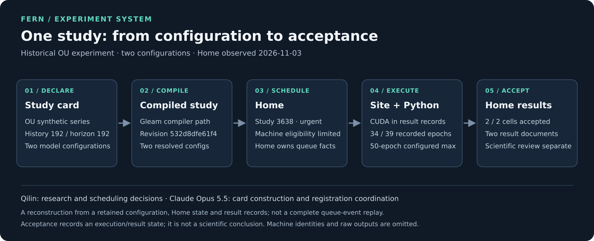

# Fern experiment system: one study from configuration to acceptance

I use Fern to study time-series forecasting under controlled conditions. As the
number of experiments grew, the practical question was not only what to run,
but how to keep the approved configuration, the actual execution and the
accepted result connected. This case follows one historical study through that
system.

## One real study

The selected study used a synthetic Ornstein–Uhlenbeck time series and two Fern
configurations. One placed the reflection chain on the time steps; the other
used a fixed sine basis. The card declared a 192-step history, a 192-step
forecast horizon, raw data units, at most 50 training epochs and patience 5.

These are selected fields from an existing study card, not a complete runnable
configuration. The two configurations were part of a wider research program;
this case explains the infrastructure and does not report which model was
better.

## From the card to the queue

1. **Declare and compile.** The authored card identified the data and two
   training cells. A retained compiled study records both resolved cell
   configurations and source revision `532d8dfe61f4`. Its compiler path points
   to the historical Gleam `fern-compile` build. The original compiler binary
   is no longer at that recorded path, so its bytes were not rechecked.
2. **Register and schedule.** Home recorded the study as **3638**. When read
   on 2026-11-03, its priority was `urgent`, and each cell had a machine
   eligibility restriction. The eligibility list says where a cell could be
   claimed; it does not by itself prove the machine that executed it.
3. **Execute.** The Site runs scientific stages through Python. The two result
   documents for this study report `cuda`, 34 and 39 training epochs
   respectively, and 2,118 evaluation windows each. The configured maximum was
   50 epochs; the fields checked do not establish why either run stopped before
   that maximum.
4. **Accept and inspect.** Home reported **2 of 2 cells accepted** and exposed
   two result documents. The recorded `config` and `config_source` in each
   document match the corresponding cell in the retained compiled study. That
   comparison links these records; it is not a complete replay of every queue
   event or proof of which exact compiled bytes Home received.

Home owns scheduling decisions and execution facts; Sites execute work; Python
owns scientific computation and result readers. The diagram is an explanatory
reconstruction from the configuration, Home state and result records, not a
Dashboard screenshot. Host identities, access paths, full result documents
and scientific scores are omitted.

## What acceptance means

An accepted result is a recorded execution and result state. It does not by
itself establish a scientific conclusion or prove that a model is correct.
Scientific interpretation still needs its own checks and comparison under the
declared conditions. The Home service, platform source and original full
records are private, so this case study is not a public one-command
reproduction.

## My contribution and AI collaboration

I developed Fern's original model and training code. For the later distributed
experiment platform, I directed research priorities, approved scientific
settings and worked with AI coding agents to build and harden the system. I
worked through scheduling and resource-management failures and turned fixes
into tested behavior.

For the study shown here, I provided the scientific decisions and scheduling
direction. Claude Opus 5.5 prepared the study cards and coordinated their
registration under those decisions. Claude Code and Codex were used in the
broader platform work; that does not mean I hand-wrote every platform component
or that an agent independently chose the scientific settings.

[Back to my profile](../README.md)
