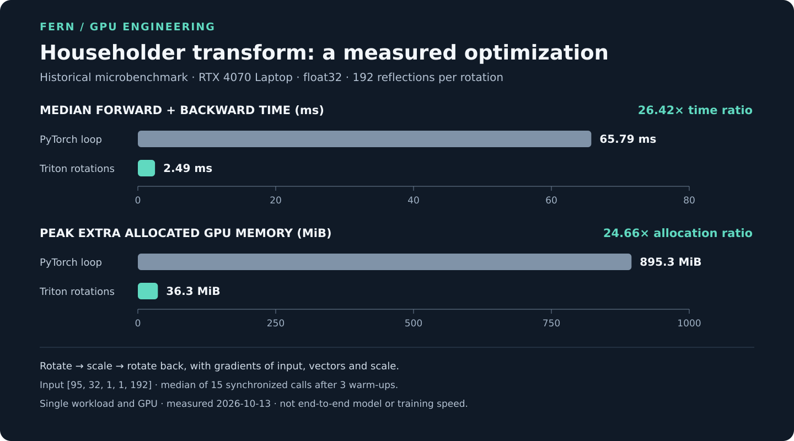

# Householder transforms: a GPU microbenchmark

Fern uses Householder reflections as part of its geometric forecasting model.
This case study shows one optimization of that computation and a historical
measurement of its cost. It is a **single-configuration microbenchmark**, not a
measurement of a full model, training step, or end-to-end speedup.

## What was measured

The measured operation rotates an input through a sequence of Householder
reflections, multiplies it by a scale, and rotates it back. The timing includes
the forward computation and gradients of the input, reflection vectors, and
scale. The revised Triton kernel fuses each rotation's reflection chain; the
complete rotate–scale–rotate-back operation is not one fused kernel.

| Implementation | Median forward + backward | Peak extra allocated GPU memory |
| --- | ---: | ---: |
| PyTorch loop | 65.79 ms | 895.3 MiB |
| Triton rotation kernels | 2.49 ms | 36.3 MiB |

For these displayed values, the PyTorch-to-Triton ratios are **26.42× for
elapsed time** and **24.66× for peak extra allocation**. They are ratios of
rounded measurements from this one workload; they are not estimates of a
universal speedup.

The selected run used an RTX 4070 Laptop GPU, float32 and random inputs with
layout `[N, S, C, G, P] = [95, 32, 1, 1, 192]`: 95 batch windows, 32
predictive draws per window, one channel, one time block, and 192 steps per
block. Each rotation used `R = 192` reflections. The reflection vectors were
shared across the 32 draws.

The record reports the median of 15 calls after three warm-up calls, with
`torch.cuda.synchronize()` around each call. Elapsed time includes host dispatch
and synchronization overhead. It also records a 42% per-process card cap;
this is not a measurement of device utilization. Peak extra allocation means
`torch.cuda.max_memory_allocated()` during one forward and backward, less the
allocation before that operation; it is not total device memory or allocator
reserved memory. No model training was involved.

## Numerical check and limitations

For this same configuration, the recorded float32 Triton result had relative
norm error **5.9e-7** for the value and **1.7e-6** for the reflection-vector
gradient against the **float64 Triton kernel**. Relative norm error is the norm
of the difference divided by the norm of the reference. This is one numerical
check, not a guarantee for every input. The vector-gradient reconstruction
requires unit-length reflection vectors; the retained excerpt does not establish
the benchmark's input-generation details.

The [selected measurement excerpt](evidence/householder-benchmark-excerpt.txt)
is copied from the original record. The original runnable benchmark script,
individual timing samples, seed, and complete software and driver versions are
not included in this case study, so the excerpt alone cannot fully reproduce the
measurement. No additional benchmark was run for this presentation. The kernel
implementation is not published in this case study.

## My contribution and AI collaboration

I wrote Fern's first fused Triton kernel for this reflection chain and directed
the later AI-assisted rewrite. I identified the memory and compilation concerns,
specified the optimization goals, and approved the integration into Fern's
Triton backend.

Claude Opus 5.5 implemented the revised reflection-chain kernel and tests, then
connected it to the backend with my approval. An independent AI reviewer
examined the implementation. The historical comparison above is against the
**PyTorch loop**, not against my earlier Triton kernel.

[Back to my profile](../README.md)
