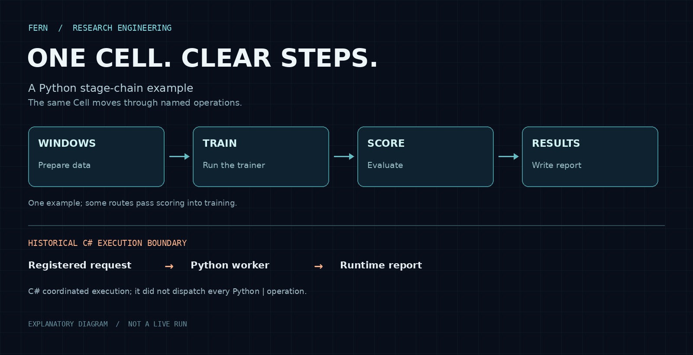

# Fern and SERIE: named stages, explicit boundaries

Research code changes quickly. A useful experiment system should make the order
of operations visible, keep a change close to the operation that owns it, and
connect execution to a report. This case shows concrete pieces of that design
in Python and in the retired C# execution system.



The upper line is one Python example, not the order of every study. Some routes
pass scoring into the training stage; checkpoint evaluation can follow another
path. The lower line shows a separate, historical execution boundary; it is not
a live run.

## Python: `|` makes operations readable

Adapted from a Fern cell source example, this chain describes one cell's data
preparation, training, scoring and result writing:

```python
cell = (
    cell
    | StageWindows(bundle)
    | StageTrain()
    | StageScore()
    | StageResults(path=results_path)
)
```

`|` is Python operator overloading, not a shell pipe. The cell's actual method
is small:

```python
def __or__(self, step: CellStep) -> Cell:
    return step.apply(self)
```

Each operation receives the cell and returns a cell for the next operation.
A missing input can name the producing stage. Fern also has conditional stages,
so a model-specific diagnostic can be included without making every model
implement it. The example and method above are from the Fern source snapshot
`3bf258bab531`, `python/fern/runtime/cell.py`; the full current research
repository is not published here.

[SERIE's public pipeline](https://github.com/QilinWang/serie/blob/8874bcc99e21b540cb8f7fe3cc22cf2f76eefdd3/pipeline.py#L252-L300)
uses the same idea for data preparation. There is a useful distinction:
`bundle | stage` applies a stage to the bundle, whereas `stage_a | stage_b`
first constructs a `BundlePlan` that can later be applied in order.

## Put a state change in the operation that names it

In the public SERIE version above, the stage definitions use frozen `attrs`
records, while `DataBundle` is the mutable object being prepared.
[`StageSplitByFraction`](https://github.com/QilinWang/serie/blob/8874bcc99e21b540cb8f7fe3cc22cf2f76eefdd3/pipeline.py#L1068-L1088)
calculates and records the split indices. [`StageInjectNoise`](https://github.com/QilinWang/serie/blob/8874bcc99e21b540cb8f7fe3cc22cf2f76eefdd3/pipeline.py#L1146-L1175)
sets the observed series and noise level. For a nonzero noise level it assigns a new array to the bundle; it does not
mutate the original NumPy array in place. A zero level records the level and
returns without that array assignment.

The same principle appears at a different layer in Fern: `StageInitialize`
requires a trainer, calls a supplied writer on its model, and records the
initialization label and returned detail. That gives a reader a named place to
look for this write. It is a design convention and an observable code path,
not a guarantee that every mutation in the whole codebase occurs in a stage or
that every failed write is automatically rolled back.

## Typed descriptions at boundaries

A historical training-schema design described one language-neutral schema
feeding Python boundary types generated with Pydantic and C# records, with
`attrs` used for Python internals. The objective was to avoid independently
spelling the same configuration in each language. That is a design record, not
a claim that every current path still uses those libraries.

The code has evolved: the public SERIE snapshot cited above uses `attrs`; a
later research-tree version uses dataclasses and `msgspec` for many records,
while some boundaries still use Pydantic. A type annotation alone does not
validate every direct Python construction. These distinctions matter when
reading a particular version.

## How the retired C# system called Python

The historical C# worker built a request from a registered study, launched the
Python stage runtime and read its report. The public
[worker](https://github.com/QilinWang/fern-retired/blob/393139cacf2ad93f9652ff858f167c10aac0605a/csharp/src/csharp/Fern.Scheduler/LocalCellWorker.cs#L10-L31)
and [stage runner](https://github.com/QilinWang/fern-retired/blob/393139cacf2ad93f9652ff858f167c10aac0605a/csharp/src/csharp/Fern.Site/StageAttemptSite.cs#L275-L299)
show that boundary, including `python -m fern_stage_runtime run`, a request and
workspace. C# supervised an execution; it did not invoke every Python `|`
operation individually. The C# implementation is retired; later Fern
infrastructure uses Gleam Home and Site with Python scientific stages.

## A performance question, still open

A [retired Rust Lorenz benchmark program](evidence/lorenz_bench.rs.txt) warms up,
then records timing, trajectory length, repetitions and a trajectory fingerprint.
This is a source snapshot, not a complete standalone Rust project. NumPy runs
many array operations in compiled code; Numba can JIT-compile supported Python
numeric functions; Rust is compiled ahead of time. A useful comparison needs
the same numerical task, inputs, outputs and timing boundaries, including a
clear account of compilation and data conversion. No matched Rust / NumPy /
Numba measurement has yet been located, so this case makes no relative-speed
claim.

## Contribution and evidence

I developed Fern's original model and training code and directed the research
and system decisions. I worked with AI coding agents on the later platform and
its documentation; this description does not attribute every implementation
line to me. The diagram is an explanatory reconstruction from source, not a
recorded execution or a performance measurement. [A separate case](fern-experiment-system.md)
follows one study's recorded configuration and acceptance.

[Back to my profile](../README.md)
